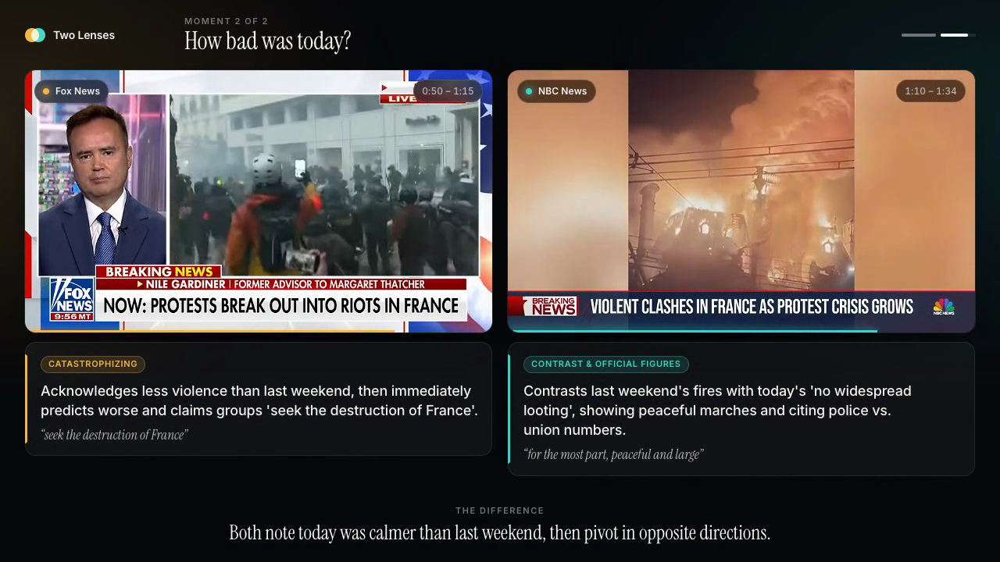
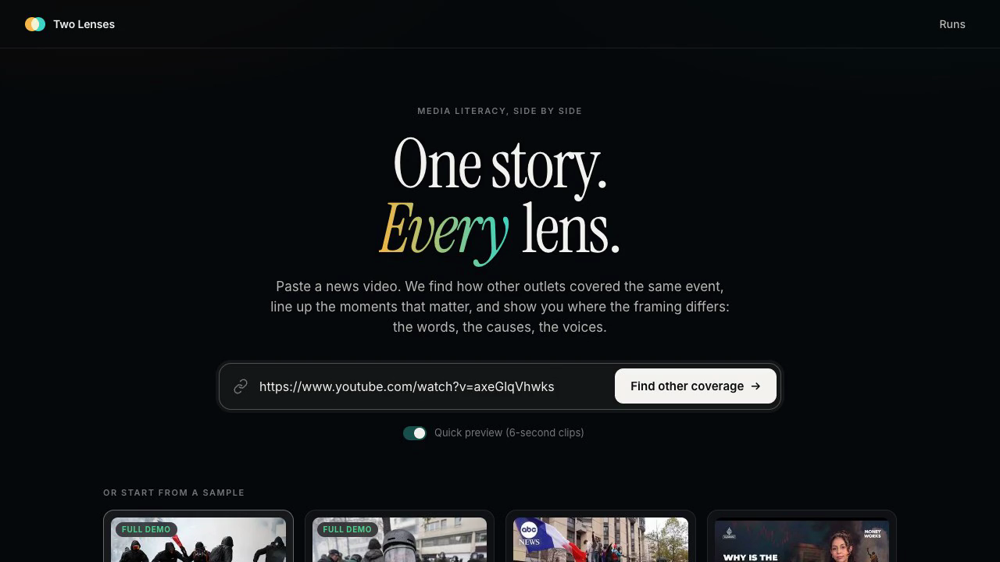
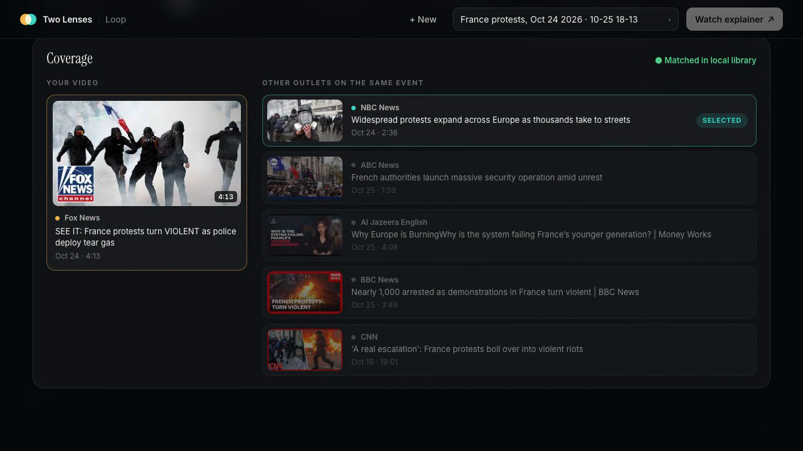
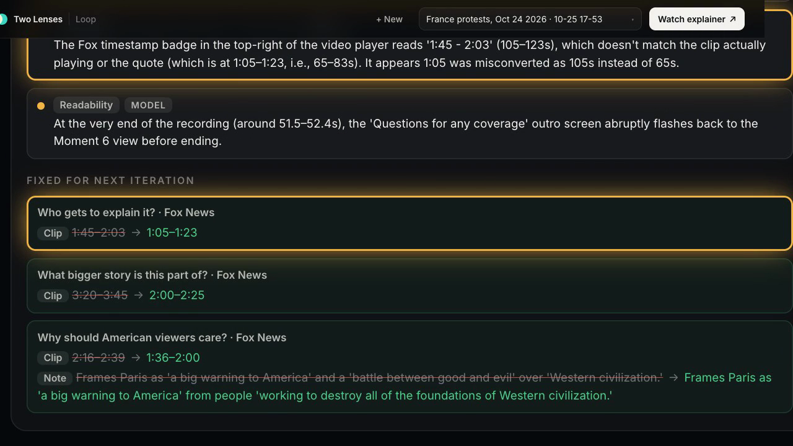
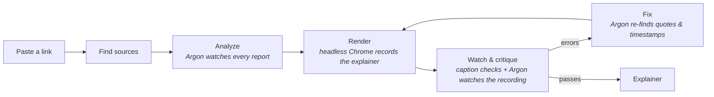

<div align="center">

# Two Lenses

### One story. *Every* lens.

Paste one news video. See how other outlets covered the same event, side by side, and exactly where the framing differs.


[](https://github.com/sosthoff/two-lenses/raw/main/docs/demo.mp4)

**[▶ Watch the 1-minute demo](https://github.com/sosthoff/two-lenses/raw/main/docs/demo.mp4)**

</div>

---

## The problem

Most people see one outlet's version of a story. On October 24, 2026, police counted 400,000 people on the streets of France. One network's headline called them **"rioters"**. Another said the protests were **"for the most part peaceful and large"**. Neither is lying; each is choosing. You only notice the choices when you see both.

Two Lenses is for anyone who wants to step outside their media bubble, and for the teachers and librarians who run media-literacy classes and need real, current, timestamped examples instead of abstract lectures.

## What it does

<table>
  <tr>
    <td width="33%"></td>
    <td width="33%"></td>
    <td width="33%"></td>
  </tr>
  <tr>
    <td><b>1. Paste a video.</b> Any YouTube news report.</td>
    <td><b>2. Find other coverage.</b> Same event, outlets with a different perspective.</td>
    <td><b>3. Render, watch, fix.</b> Argon reviews its own explainer and corrects it.</td>
  </tr>
</table>

The result is a side-by-side explainer: both reports play in sync, one *moment* at a time (first words, stated cause, who gets to explain, how bad it was, why viewers should care), each with a named framing technique, a verbatim quote and its timestamp. It ends with questions to ask of *any* coverage.

## The loop



1. **Find sources.** Reads the video's metadata, writes neutral search queries, searches YouTube, ranks the candidates and downloads the best reports from other outlets. Links already in the local library resolve offline.
2. **Analyze.** Argon watches every report in full and pairs the moments that answer the same question.
3. **Render.** The explainer plays in headless Chrome and is recorded to video, with a timeline of when each moment is on screen.
4. **Watch & critique.** Two critics score **grounding**, **fairness** and **readability**:
   - *Deterministic checks*: every quote must appear in the captions inside its clip (tolerant of "uh", repeats and plurals); every outlet in a moment gets the same scrutiny; notes are short enough to read.
   - *Argon* watches the rendered recording **and** the sources, and reports timestamped issues.
5. **Fix.** Argon patches the explainer and the loop re-renders until no errors remain.

**Fairness is a first-class criterion.** The critic flags any moment where one outlet is scrutinized and the other isn't, and outlets get neutral colors (amber, teal), never red and blue.

## Why it needs Gemini 4 Argon

- **Long video, many sources, one context.** Every report is watched end to end, together, so moments can be paired across outlets (audio, on-screen captions and B-roll).
- **It watches its own output.** The critic sees the rendered explainer as a viewer would, then checks it against the sources.
- **Real self-correction.** In our first run Argon's critic caught that the analysis had written *1:05* as *105 seconds*, explained the mistake, and moved every affected clip back to where the words are actually said.

## Results from the hackathon

| Argon's first draft | Grounding | Fairness | Readability | Result |
|---|---|---|---|---|
| First run | 0.55 | 0.90 | 0.85 | fail: 3 clips at wrong timestamps |
| After the fixes that run surfaced (time format, recording format, critic context) | **0.90** | **0.95** | **0.85** | **pass on first iteration** |

Argon also found framing patterns we had missed by hand: both outlets acknowledge the day was calmer than the previous weekend, then pivot in opposite directions ("it's going to get a lot worse" vs. "no widespread looting").

## Run it

Requires Node 22+, ffmpeg, yt-dlp and Google Chrome (Playwright uses it to decode H.264).

```bash
npm install
npx playwright install ffmpeg
echo 'GEMINI_API_KEY=...' > .env   # without a key, a stub model runs the bundled sample
npm run serve                       # http://localhost:4317
```

The sample videos are not in the repo (copyright). Fetch them with the IDs listed in [`samples/france-protests/README.md`](samples/france-protests/README.md), e.g.:

```bash
cd samples/france-protests
yt-dlp -f "bv*[height<=480][ext=mp4]+ba[ext=m4a]" --merge-output-format mp4 \
  --write-info-json --write-auto-subs --sub-langs en -o "fox_see-it-violent.%(ext)s" -- axeGlqVhwks
```

From the command line:

```bash
npm run loop                                                  # curated France sample
node src/loop.js --url "https://youtu.be/<id>"                # any video: discover → analyze → loop
node src/loop.js samples/france-protests/set.json --maxSeg 6  # quick preview clips
node scripts/demo-video.mjs                                   # re-record the demo video
```

## Project layout

| Path | What |
|---|---|
| `launch/` | Paste-a-link landing page |
| `viewer/` | Live loop view: stepper, coverage found, scores per iteration, before → after diffs |
| `player/` | The explainer itself (interactive, or `mode=reel` for recording) |
| `src/loop.js` | Orchestrates discover → analyze → render → critique → fix |
| `src/discover.js` | Finding alternative coverage (local library or YouTube) |
| `src/checks.js`, `src/captions.js` | Deterministic grounding, fairness and readability checks |
| `src/models/gemini.js` | Gemini 4 Argon: search queries, ranking, analysis, critique, fix |
| `src/models/stub.js` | Offline stand-in with a hand-written, deliberately flawed draft |
| `prompts/` | Analyze, critique and fix prompts |
| `scripts/demo-video.mjs` | Records the demo video from the running app |

## License

MIT. News clips shown in the screenshots and demo belong to their respective outlets and are used for commentary and education.
